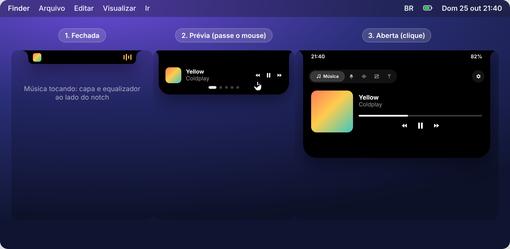
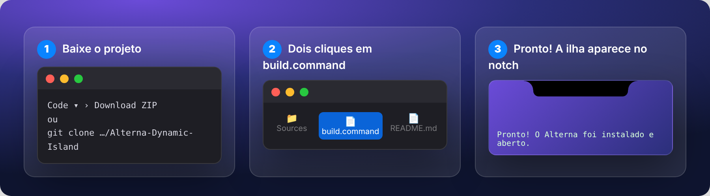
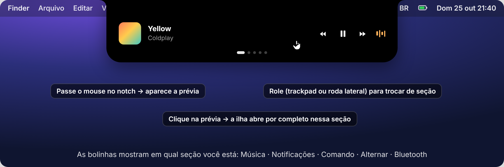
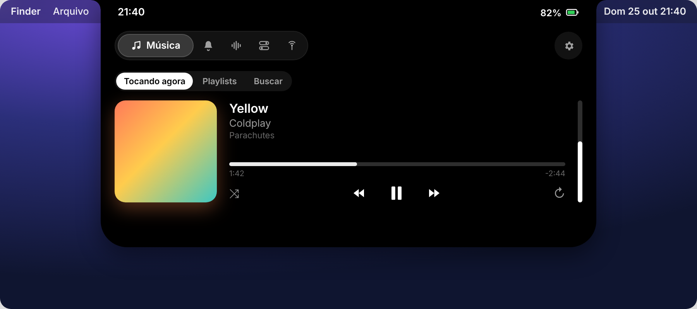
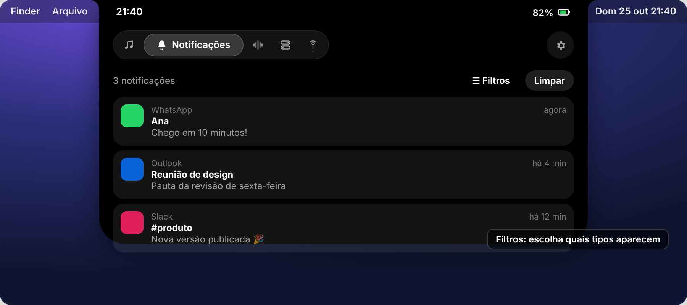
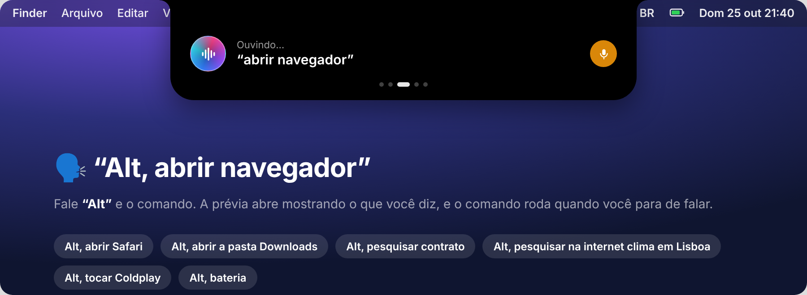
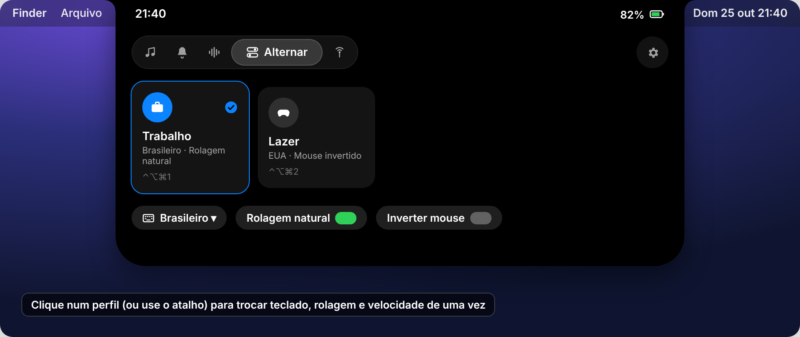
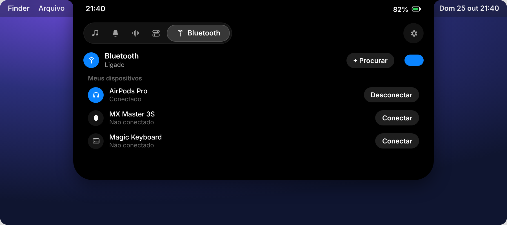
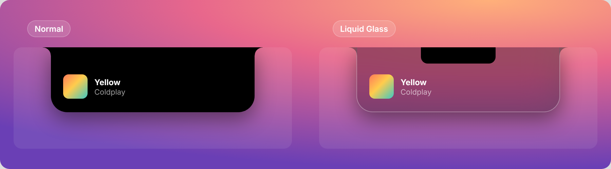

# Alterna – Dynamic Island

A Dynamic Island do iPhone, agora no notch do seu MacBook. Feita em **Swift + SwiftUI** e seguindo as **Human Interface Guidelines** da Apple.

Num só lugar, no topo da tela:

- **Música:** controle o Spotify e veja suas playlists.
- **Notificações:** veja as notificações do Mac, com filtro por tipo.
- **Comando de voz:** diga *"Alt, abrir navegador"*.
- **Alternar:** troque teclado, rolagem e mouse entre trabalho e lazer com um atalho.
- **Bluetooth:** ligue, conecte e pareie dispositivos.



> As imagens deste README são ilustrações da interface. A aparência real pode variar um pouco.

---

## Sumário

1. [Requisitos](#requisitos)
2. [Instalação](#instalação)
3. [Primeiro uso e permissões](#primeiro-uso-e-permissões)
4. [Como usar a ilha](#como-usar-a-ilha)
5. [Funcionalidades](#funcionalidades)
   - [Música (Spotify)](#-música-spotify)
   - [Notificações](#-notificações)
   - [Comando de voz ("Alt")](#-comando-de-voz-alt)
   - [Alternar (teclado, rolagem e mouse)](#-alternar-teclado-rolagem-e-mouse)
   - [Bluetooth](#-bluetooth)
6. [Aparência: Normal ou Liquid Glass](#aparência-normal-ou-liquid-glass)
7. [Atalhos de teclado](#atalhos-de-teclado)
8. [Configurações opcionais](#configurações-opcionais)
9. [Solução de problemas](#solução-de-problemas)
10. [Limitações conhecidas](#limitações-conhecidas)
11. [Estrutura do projeto](#estrutura-do-projeto)

---

## Requisitos

- Mac com **macOS 14 (Sonoma) ou mais novo**. Funciona melhor num MacBook com notch.
- **Ferramentas de Linha de Comando do Xcode.** Para instalar, abra o Terminal e rode:

  ```bash
  xcode-select --install
  ```

- Opcional: **Spotify** instalado, para a seção Música.

## Instalação



### 1. Baixe o projeto

Clique em **Code ▾ › Download ZIP** nesta página e descompacte. Ou, no Terminal:

```bash
git clone https://github.com/lucasccipriano/Alterna-Dynamic-Island.git
```

Coloque a pasta onde preferir, por exemplo em `Documentos/Alterna`.

### 2. Compile e instale com dois cliques

Na pasta do projeto, dê **dois cliques em `build.command`**. Ele faz tudo sozinho:

1. compila o app;
2. cria uma assinatura local fixa (só na primeira vez);
3. instala em **/Applications**;
4. abre o Alterna.

O resultado da compilação fica em `build.log`. Se preferir o Terminal:

```bash
cd ~/Documentos/Alterna   # a pasta onde você colocou o projeto
bash build.sh
```

> **Na primeira compilação**, o macOS pode mostrar uma janela pedindo a senha do Mac para o `codesign` usar a chave **"Alterna Local Signing"**. Digite a senha e clique em **Permitir Sempre**. Essa assinatura fixa faz o macOS reconhecer o Alterna como o mesmo app a cada atualização, e assim as permissões não são pedidas de novo.

> Se o macOS bloquear a abertura, vá em **Ajustes do Sistema › Privacidade e Segurança**, role até o fim e clique em **Abrir Mesmo Assim**.

### 3. Pronto

A ilha aparece no notch. O Alterna não tem ícone no Dock nem na barra de menus: tudo acontece na ilha.

Para **atualizar** depois de mudar o código, é só dar dois cliques em `build.command` de novo.

## Primeiro uso e permissões

O macOS pede cada permissão na primeira vez que você usa a função correspondente:

| Permissão | Para quê | Onde fica |
| --- | --- | --- |
| **Automação › Spotify** | Controlar o player | Pedido automático ao abrir a seção Música |
| **Acesso Total ao Disco** | Ler as notificações | Ajustes do Sistema › Privacidade e Segurança › Acesso Total ao Disco |
| **Microfone** e **Reconhecimento de Fala** | Comando de voz | Pedido automático na primeira vez que você fala |
| **Bluetooth** | Seção Bluetooth | Pedido automático ao abrir a seção |
| **Acessibilidade** | Inverter só a roda do mouse | Ajustes do Sistema › Privacidade e Segurança › Acessibilidade |

## Como usar a ilha

A ilha tem três estados:

| Estado | Como chegar | O que mostra |
| --- | --- | --- |
| **Fechada** | Normal | Fica do tamanho do notch. Com música tocando, mostra a capa e um equalizador ao lado. |
| **Prévia** | **Passe o mouse** no notch | Um resumo da seção. **Role** para ver as outras seções. |
| **Aberta** | **Clique** no notch ou na prévia | A seção completa, com o seletor de seções no topo. |



Para trocar de seção com a ilha aberta:

- clique no **seletor** no topo, que mostra o ícone e o nome da seção ativa;
- **deslize dois dedos** no trackpad;
- gire a **roda lateral do mouse** (ou use **Shift + roda**);
- use as **setas ← →** do teclado.

A **⚙︎ engrenagem** na ponta direita abre os **Ajustes**. Com o botão direito, ela mostra a opção **Sair**. Para sair da ilha, tire o mouse, clique fora dela ou aperte **Esc**.

---

## Funcionalidades

### 🎵 Música (Spotify)



**Como ativar:** abra o Spotify e passe o mouse no notch. A prévia mostra a música atual. Clique para abrir a seção **Música**.

- **Tocando agora:** capa, faixa e artista; barra de progresso que você pode arrastar; anterior, tocar/pausar e próxima; aleatório; repetir; e volume (a barra vertical).
- **Playlists:** **Músicas Curtidas** em primeiro lugar e depois suas playlists, em grade. Clique para tocar.
- **Buscar:** músicas, artistas, álbuns e playlists. Clique para tocar.
- **Na ilha fechada:** enquanto toca, aparecem a capa e um equalizador ao lado do notch.

> Playlists e busca dentro da ilha precisam [conectar o Spotify](#conectar-o-spotify-playlists-e-busca). Sem isso, o player funciona normalmente e a busca abre no próprio app do Spotify.

### 🔔 Notificações



**Como ativar:**

1. Dê **Acesso Total ao Disco** ao Alterna em Ajustes do Sistema › Privacidade e Segurança.
2. Abra a seção **Notificações**.

O que dá para fazer:

- **Clique** numa notificação para abrir o app.
- Passe o mouse e clique no **✕** para dispensar.
- **Clique com o botão direito** para silenciar aquele app ou aquele tipo.
- Em **Filtros**, ligue e desligue cada tipo: E-mail, Mensagens e chat, Redes sociais, Agenda e lembretes, Sites (navegadores), Sistema, Outros apps.
- Em **Ajustes › Notificações**, ligue e desligue **app por app**.
- Quando chega uma notificação nova, ela aparece como **banner na ilha**. Isso também pode ser desligado.

### 🎙️ Comando de voz ("Alt")



**Como ativar:** só fale. Com a ativação ligada (ela já vem ligada), diga **"Alt"** e o comando na mesma frase:

> **"Alt, abrir navegador"**

O que acontece:

1. Ao ouvir "Alt", toca um som curto e a **prévia da ilha abre mostrando "Ouvindo…"** com o que você está dizendo.
2. Quando você para de falar, o comando é executado e a ilha mostra o resultado.

Outras formas de falar um comando:

- **Botão:** clique na **esfera** na seção Comando.
- **Atalho:** aperte **⌃⌥⌘V**.
- **Siri:** diga "E aí Siri, Alterna" (veja [Siri](#usar-com-a-siri)).
- **Texto:** digite no campo da seção Comando.

Exemplos de comandos:

| Você diz | O que acontece |
| --- | --- |
| "Alt, abrir navegador" | Abre o seu navegador padrão |
| "Alt, abrir Safari" / "abrir Notas" | Abre o app |
| "Alt, abrir a pasta Downloads" | Abre a pasta no Finder |
| "Alt, abrir contrato.pdf" | Abre o arquivo |
| "Alt, pesquisar relatório" | Procura nos seus arquivos (Spotlight) |
| "Alt, pesquisar na internet clima em Lisboa" | Pesquisa no Google |
| "Alt, tocar Coldplay" / "pausar" / "próxima música" | Controla o Spotify |
| "Alt, tocar músicas curtidas" | Toca suas Músicas Curtidas |
| "Alt, bateria" / "armazenamento" / "memória" / "versão do macOS" / "que horas são" | Informações do Mac |

**Para desligar o microfone**, clique no **botão de microfone laranja** na prévia ou na seção Comando, ou desligue em **Ajustes › Comando de voz › Ativação por voz**.

Nesses mesmos Ajustes você também pode:

- trocar a palavra de ativação;
- deixar a escuta ligada só quando o Mac estiver na tomada;
- abrir o **Diagnóstico**, que mostra permissões, microfone e a última frase ouvida.

> Com a ativação ligada, o microfone fica aberto, e o macOS mostra o **ponto laranja** na barra de menus. O reconhecimento roda no próprio Mac quando o idioma permite. O Alterna usa o **microfone embutido** do Mac, então seus fones Bluetooth continuam com som de alta qualidade.

### 🔀 Alternar (teclado, rolagem e mouse)



**Como ativar:** use os atalhos **⌃⌥⌘1** (Trabalho) e **⌃⌥⌘2** (Lazer), clique num perfil na seção **Alternar** ou na prévia. **⌃⌥⌘Espaço** passa para o próximo perfil.

Cada perfil pode mudar:

- **Fonte de entrada do teclado** (ex.: Português ABNT2 ↔ EUA).
- **Rolagem natural**, ligada ou desligada.
- **Roda do mouse invertida.** Inverte só o mouse e deixa o trackpad como está.
- **Velocidade do cursor** do mouse e do trackpad.

Para criar e editar perfis:

1. Abra **Ajustes** e escolha o perfil na barra lateral (ou crie um novo com **+**).
2. Defina o atalho e os ajustes que quiser mudar. O que ficar em **"Não alterar"** não é mexido.
3. Dica: configure o Mac do jeito que quer e clique em **"Copiar ajustes atuais do Mac"**.

A seção também tem controles rápidos para trocar o teclado, a rolagem natural e a inversão do mouse sem precisar de perfil.

### 📶 Bluetooth



**Como ativar:** abra a seção **Bluetooth**.

- **Ligar e desligar** o Bluetooth pelo botão no topo.
- **Conectar e desconectar** dispositivos pareados com um clique.
- **Parear um aparelho novo:** coloque o aparelho em modo de pareamento, clique em **+ Procurar** e depois em **Parear**.
- A prévia mostra quais aparelhos estão conectados.

---

## Aparência: Normal ou Liquid Glass



Em **Ajustes › Geral › Aparência**, escolha:

- **Normal:** preta, como a Dynamic Island do iPhone.
- **Liquid Glass:** vidro escuro translúcido que desfoca o que está atrás. A parte embaixo da câmera continua preta para combinar com o notch.

## Atalhos de teclado

| Atalho | Ação |
| --- | --- |
| **⌃⌥⌘I** | Abrir e fechar a ilha |
| **⌃⌥⌘V** | Falar um comando |
| **⌃⌥⌘1 / ⌃⌥⌘2** | Perfis Trabalho / Lazer |
| **⌃⌥⌘Espaço** | Próximo perfil |
| **← →** | Trocar de seção (ilha aberta) |
| **Esc** | Fechar a ilha |

Todos podem ser trocados nos **Ajustes**.

## Configurações opcionais

### Conectar o Spotify (playlists e busca)

O Spotify exige um app de desenvolvedor gratuito. Desde 2026, a conta dona desse app precisa ser **Premium**.

1. Acesse o [painel de desenvolvedor do Spotify](https://developer.spotify.com/dashboard) e clique em **Create app**.
2. Em **Redirect URIs**, adicione exatamente:

   ```
   http://127.0.0.1:43821/callback
   ```

3. Marque **Web API** e salve.
4. Copie o **Client ID** e cole em **Ajustes do Alterna › Música**.
5. Clique em **Entrar com o Spotify** e autorize no navegador.

### Usar com a Siri

1. Abra o app **Atalhos** e crie um atalho chamado **Alterna**.
2. Adicione a ação **Abrir URLs** com o endereço `alterna://ouvir`.
3. Diga **"E aí Siri, Alterna"**. A ilha abre ouvindo.

Links aceitos pelo app:

- `alterna://ouvir`: abre a ilha ouvindo.
- `alterna://comando?texto=abrir%20notas`: executa um comando de texto.
- `alterna://pagina/musica`: abre uma seção. Valem `musica`, `notificacoes`, `comando`, `alternar` e `bluetooth`.

## Solução de problemas

| Problema | Solução |
| --- | --- |
| Compilação falhou | Abra `build.log` na pasta do projeto e veja a mensagem de erro. Confira se rodou `xcode-select --install`. |
| O macOS pede permissões toda vez | Use sempre o `build.command`, que assina com o certificado local fixo. Se uma permissão aparece ligada mas não funciona, remova o Alterna da lista (**−**) e adicione de novo. |
| "Alt" não responde | Abra **Ajustes › Comando de voz › Diagnóstico**. Confira as permissões de **Fala** e **Microfone**, se o áudio está chegando e qual foi a **última frase ouvida**. Use **Reiniciar escuta**. |
| As notificações não aparecem | Dê **Acesso Total ao Disco** e clique em **Já permiti** na seção Notificações. |
| O Spotify não responde | Permita o Alterna em Ajustes do Sistema › Privacidade e Segurança › **Automação › Spotify**. |
| Onde estão os Ajustes? | Use a engrenagem da ilha aberta, ou abra o Alterna de novo em **Aplicativos**. |

## Limitações conhecidas

- **Notificações:** o macOS não tem uma forma oficial de outros apps lerem notificações. O Alterna lê uma cópia do banco da Central de Notificações, e isso pode mudar numa atualização do sistema.
- **Funções internas do macOS:** rolagem natural, velocidade do cursor, ligar e desligar o Bluetooth e o cursor em segundo plano usam funções internas do sistema.
- **Busca Bluetooth:** a busca por aparelhos novos encontra Bluetooth clássico. Alguns teclados e mouses só pareiam pelos Ajustes do Sistema.
- **Liquid Glass:** é uma recriação com o desfoque do macOS, não o material oficial do macOS 26.
- **Distribuição:** o app não usa sandbox. É para uso pessoal, fora da Mac App Store.

## Estrutura do projeto

```
Sources/Alterna/
  App/            entrada do app, ajustes, janela de Ajustes, links alterna://
  Island/         a Dynamic Island: janela no notch, formas, animações, prévia, seletor
  Features/
    Music/        Spotify (AppleScript + Web API)
    Notifications/ leitura e filtros de notificações
    Voice/        reconhecimento de fala, "Alt", comandos, Spotlight
    Profiles/     seção Alternar
    Bluetooth/    IOBluetooth
  Models/         perfis
  System/         teclado, rolagem, velocidade, atalhos globais, microfone
  Views/          telas de Ajustes
Support/Info.plist
build.sh          compila, assina, instala e abre
build.command     o mesmo, com dois cliques
```
